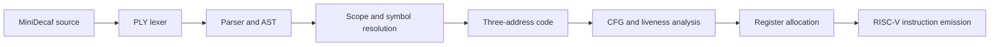

# MiniDecaf RISC-V Compiler

An incremental compiler for the MiniDecaf C-like language, written in Python
and targeting 32-bit RISC-V assembly. The compiler lowers source through an AST,
semantic analysis, three-address code, control-flow and liveness analysis,
register allocation, and target instruction selection.

This repository preserves five cumulative development stages and their original
commit history. The `main` branch starts from the final stage and adds a
portfolio overview, architecture notes, examples, and continuous integration.

> **Scope.** This is an educational compiler for the MiniDecaf subset, built on
> the course-provided Python framework. It accepts integer programs and supports
> scalar variables, expressions, control flow, and functions. It is not a
> complete C compiler.

## Compiler pipeline



The implementation keeps each intermediate representation explicit. AST nodes
are progressively annotated with symbols and temporary values; the backend
converts TAC instructions into a control-flow graph, assigns registers with
liveness information, and lowers the result to RV32 assembly.

## Language coverage

- Integer literals, variables, assignment, and nested lexical scopes.
- Unary operators `-`, `~`, and `!`.
- Arithmetic, comparison, and logical operators, including `&&` and `||`.
- `if`/`else`, `while`, `for`, `break`, `continue`, and conditional expressions.
- Multiple functions, parameters, calls, and recursion.
- RV32 stack frames, argument registers, return values, and save/restore of
  used callee-saved registers.

The final snapshot does not implement pointers, arrays, global variables,
structs, floating-point operations, preprocessing, or machine-independent
optimizations beyond unreachable-block filtering and register allocation.

## Development stages

| Stage | Branch | Main contribution |
| --- | --- | --- |
| 1 | [`stage-1`](../../tree/stage-1) | Scalar expressions, arithmetic and logical operators, TAC operations, and initial RV32 instruction selection |
| 2 | [`stage-2`](../../tree/stage-2) | Variable declaration, lookup and assignment; symbol-to-TAC temporary binding |
| 3 | [`stage-3`](../../tree/stage-3) | Nested lexical scopes; CFG reachability analysis; skipping unreachable blocks during register allocation |
| 4 | [`stage-4`](../../tree/stage-4) | Conditional expressions, `for` and `continue`, optional loop clauses, and loop-control validation |
| 5 | [`stage-5`](../../tree/stage-5) | Function definitions, parameter passing, calls, recursion, frame management, and caller/callee-saved register handling |

The branches are cumulative: `stage-2` extends `stage-1`, and so on. `main`
contains the same compiler source as `stage-5`, plus repository documentation
and CI.

## Quick start

Python 3.9 or newer is required.

```bash
git clone <repository-url>
cd <repository-name>

python -m venv .venv
# Activate the environment for your shell, then:
python -m pip install -r requirements.txt
```

Compile the recursive Fibonacci example into each representation:

```bash
python main.py --input example.c --parse
python main.py --input example.c --tac
python main.py --input example.c --riscv > example.s
```

The `examples/` directory includes an additional control-flow program covering
`for`, `if`, `continue`, and a conditional expression.

## Repository structure

| Path | Responsibility |
| --- | --- |
| `frontend/lexer/` | PLY lexer and token definitions |
| `frontend/parser/` | Grammar and AST construction |
| `frontend/typecheck/` | Symbol resolution, scope handling, and semantic checks |
| `frontend/tacgen/` | AST-to-TAC lowering |
| `backend/dataflow/` | Basic blocks, CFG construction, and liveness analysis |
| `backend/reg/` | Register allocation |
| `backend/riscv/` | TAC-to-RISC-V instruction selection and emission |
| `utils/tac/` | TAC instructions, temporaries, and function containers |
| `utils/riscv.py` | RISC-V registers and backend instruction classes |

Useful review entry points:

- [`frontend/tacgen/tacgen.py`](frontend/tacgen/tacgen.py): AST lowering and
  control-flow lowering.
- [`frontend/typecheck/namer.py`](frontend/typecheck/namer.py): scope and symbol
  resolution.
- [`backend/dataflow/cfg.py`](backend/dataflow/cfg.py): control-flow graph and
  reachable-block analysis.
- [`backend/reg/bruteregalloc.py`](backend/reg/bruteregalloc.py): liveness-based
  register assignment.
- [`backend/riscv/riscvasmemitter.py`](backend/riscv/riscvasmemitter.py):
  instruction selection, prologues, epilogues, and function calls.

More detail is available in [Architecture and Design](docs/ARCHITECTURE.md).

## Verification

Local checks performed for the portfolio snapshot:

- all Python modules compile with `python -m compileall`;
- every `stage-1` through `stage-5` branch generates non-empty RISC-V assembly
  for its corresponding example;
- `example.c` produces an AST, TAC, and non-empty RISC-V assembly;
- the recursive Fibonacci output contains a function call and a valid function
  prologue/epilogue.

The GitHub Actions workflow repeats these checks on every push to `main`.

The official `minidecaf-tests` suite is a course-private submodule and is not
included in this repository. Clone this repository normally unless you already
have access to that test suite; using `--recurse-submodules` without the required
credentials will fail.

## Development history

The original sequence contains 24 commits across five cumulative stage branches.
The history is preserved rather than squashed: implementation commits, fixes,
reports, and the initial framework commit remain available for review.

## Provenance

This project extends the MiniDecaf Python teaching framework. The initial
framework commit and its authorship are retained. The compiler-stage
implementations and reports in the later commits document the work completed for
this project. No new standalone license is declared by this portfolio
adaptation; reuse of the framework remains subject to its original course and
upstream terms.
