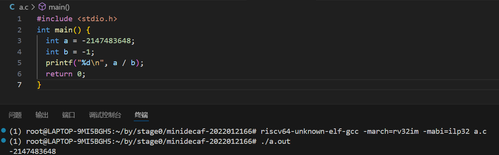

### MiniDecaf-Stage1 报告
周轻扬 2022012166 计24

##### 实验内容
1. step2
   - 在`utils/tac/tacop.py/TacUnaryOp`中添加添加对应按位取反(~)、逻辑取反(!)的中间TAC指令
     ```python
        class TacUnaryOp(Enum):
            NEG = auto()
            BIT_NOT=auto()# ~
            NOT=auto()# !
     ```
   - 在`utils/riscv.py/RvUnaryOp`中添加对应按位取反、逻辑取反的RISC-V汇编指令
     ```python
        class RvUnaryOp(Enum):
            NEG = auto()
            SNEZ = auto()
            SEQZ = auto()
            NOT = auto()
     ```
   - 在`frontend/tacgen/tacgen.py/visitUnary`中实现从AST向TAC的翻译
     ```python
        op = {
                 node.UnaryOp.Neg: tacop.TacUnaryOp.NEG,
                 node.UnaryOp.BitNot: tacop.TacUnaryOp.BIT_NOT,
                 node.UnaryOp.LogicNot: tacop.TacUnaryOp.NOT,
                 # You can add unary operations here.
             }[expr.op]
     ```
   - 在`backend/riscv/riscvasmemitter.pybackend/riscv/riscvasmemitter.py/visitUnary`中实现从TAC向RISC-V汇编的翻译
     ```python
              op = {
                  TacUnaryOp.NEG: RvUnaryOp.NEG,
                  TacUnaryOp.BIT_NOT: RvUnaryOp.NOT,# !
                  TacUnaryOp.NOT: RvUnaryOp.SEQZ# ~
                  # You can add unary operations here.
              }[instr.op]
     ```
    - 修改`utils/tac/tacinstr.py/Unary/__str__`输出符号的逻辑
       ```python
              return "%s = %s %s" % (
                  self.dst,
                  ("-" if (self.op == TacUnaryOp.NEG) else "!"),
                  # ("-" if (self.op == TacUnaryOp.NEG) else "!"),
                  ("-" if self.op == TacUnaryOp.NEG else 
                      ("~" if self.op == TacUnaryOp.BIT_NOT else 
                          ("!" if self.op == TacUnaryOp.NOT else ""))),
                  self.operand,
              )
       ```
2. step3
   - 在`utils/tac/tacop.py/TacBinaryOp`中添加添加对应-、*、/、%的中间TAC指令
     ```python
        class TacBinaryOp(Enum):
          ADD = auto()    # +
          LOR = auto()
          SUB = auto()    # -
          MUL = auto()    # *
          DIV = auto()    # /
          MOD = auto()    # %
     ```
   - 在`utils/riscv.py/RvBinaryOp`中添加对应-、*、/、%的RISC-V汇编指令
     ```python
        class RvBinaryOp(Enum):
            ADD = auto() # +
            OR = auto()
            SUB = auto() # -
            MUL = auto() # *
            DIV = auto() # /
            REM = auto() # %
     ```
   - 在`frontend/tacgen/tacgen.py/visitBinary`中实现从AST向TAC的翻译
     ```python
        op = {
            node.BinaryOp.Add: tacop.TacBinaryOp.ADD,
            node.BinaryOp.Sub: tacop.TacBinaryOp.SUB,
            node.BinaryOp.Mul: tacop.TacBinaryOp.MUL,
            node.BinaryOp.Div: tacop.TacBinaryOp.DIV,
            node.BinaryOp.Mod: tacop.TacBinaryOp.MOD,
            # You can add binary operations here.
        }[expr.op]

     ```
   - 在`backend/riscv/riscvasmemitter.pybackend/riscv/riscvasmemitter.py/visitBinary`中实现从TAC向RISC-V汇编的翻译
     ```python
        op = {
              TacBinaryOp.ADD: RvBinaryOp.ADD,
              TacBinaryOp.SUB: RvBinaryOp.SUB,
              TacBinaryOp.MUL: RvBinaryOp.MUL,
              TacBinaryOp.DIV: RvBinaryOp.DIV,
              TacBinaryOp.MOD: RvBinaryOp.REM, # %
              # You can add binary operations here.
          }[instr.op]
     ```
3. step4
   - 在`utils/tac/tacop.py/TacBinaryOp`中添加添加对应==、!=、<、<=、>、>=、&&的中间TAC指令
     ```python
        class TacBinaryOp(Enum):
          ...
          LOR = auto()    #||
          EQU=auto()    # ==
          NEQ=auto()    # !=
          SLT=auto()    # <
          LEQ=auto()    # <=
          SGT=auto()    # >
          GEQ=auto()    # >=
          AND=auto()    # &&
     ```
   - 在`utils/riscv.py/RvBinaryOp`中添加实现||、==、!=、<、<=、>、>=、&&操作所需的其他RISC-V汇编指令
     ```python
        class RvBinaryOp(Enum):
            ...
            SLT = auto() # <
            SGT = auto() # >
            AND = auto() # &
     ```
   - 在`frontend/tacgen/tacgen.py/visitBinary`中实现从AST向TAC的翻译
     ```python
        op = {
            ...
            node.BinaryOp.LogicOr: tacop.TacBinaryOp.LOR,#||
            node.BinaryOp.EQ: tacop.TacBinaryOp.EQU,#==
            node.BinaryOp.NE: tacop.TacBinaryOp.NEQ,#!=
            node.BinaryOp.LT: tacop.TacBinaryOp.SLT,#<
            node.BinaryOp.GT: tacop.TacBinaryOp.SGT,#>
            node.BinaryOp.LE: tacop.TacBinaryOp.LEQ,#<=
            node.BinaryOp.GE: tacop.TacBinaryOp.GEQ,#>=
            node.BinaryOp.LogicAnd: tacop.TacBinaryOp.AND,#&&
        }[expr.op]
     ```
   - 在`backend/riscv/riscvasmemitter.pybackend/riscv/riscvasmemitter.py/visitBinary`中实现从TAC向RISC-V汇编的翻译
     ```python
        if instr.op == TacBinaryOp.LOR:## ||，按位与后判断是否=0
            self.seq.append(Riscv.Binary(RvBinaryOp.OR, instr.dst, instr.lhs, instr.rhs))
            self.seq.append(Riscv.Unary(RvUnaryOp.SNEZ, instr.dst, instr.dst))
        elif instr.op == TacBinaryOp.EQU:#==，相减后判断是否=0
            self.seq.append(Riscv.Binary(RvBinaryOp.SUB, instr.dst,instr.lhs, instr.rhs))
            self.seq.append(Riscv.Unary(RvUnaryOp.SEQZ, instr.dst, instr.dst))
        elif instr.op == TacBinaryOp.NEQ:#!=，相减后判断是否=0
            self.seq.append(Riscv.Binary(RvBinaryOp.SUB, instr.dst, instr.lhs, instr.rhs))
            self.seq.append(Riscv.Unary(RvUnaryOp.SNEZ, instr.dst, instr.dst))
        elif instr.op == TacBinaryOp.LEQ:#<=，判断是否>后取反
            self.seq.append(Riscv.Binary(RvBinaryOp.SGT, instr.dst, instr.lhs, instr.rhs))
            self.seq.append(Riscv.Unary(RvUnaryOp.SEQZ, instr.dst, instr.dst))
        elif instr.op == TacBinaryOp.GEQ:#>=，判断是否<后取反
            self.seq.append(Riscv.Binary(RvBinaryOp.SLT, instr.dst, instr.lhs, instr.rhs))
            self.seq.append(Riscv.Unary(RvUnaryOp.SEQZ, instr.dst, instr.dst))
        elif instr.op == TacBinaryOp.AND:#&&，分别判断两个数是否!=0后将结果按位与
            self.seq.append(Riscv.Unary(RvUnaryOp.SNEZ, instr.rhs, instr.rhs))
            self.seq.append(Riscv.Unary(RvUnaryOp.SNEZ, instr.lhs, instr.lhs))
            self.seq.append(Riscv.Binary(RvBinaryOp.AND, instr.dst, instr.rhs, instr.lhs))
        else:
            op = {
                ...
                TacBinaryOp.SLT: RvBinaryOp.SLT,# <，直接翻译
                TacBinaryOp.SGT: RvBinaryOp.SGT# >，直接翻译
                # You can add binary operations here.
            }[instr.op]
     ```

##### 思考题
1. step1
   1. 在我们的框架中，从 AST 向 TAC 的转换经过了 namer.transform, typer.transform 两个步骤，如果没有这两个步骤，以下代码能正常编译吗，为什么？
      ```python
       int main(){
           return 10;
       }
      ```
      答：可以正常编译。namer.transform用于符号表构建，typer.transform用于类型检查，而此处没有需要进行解析的变量、函数等符号，也没有需要进行类型检查的变量，故没有这两个步骤不影响代码编译
   2. 我们的框架现在对于 return 语句没有返回值的情况是在哪一步处理的？报的是什么错？
       答：在`fronted/parser/ply_parser.py`，即在语法分析时，通过p_error函数，在解析至t而t为空时，生成DecafSyntaxError错误，提示为EOF。
       ```python
          if not t:
           error_stack.append(DecafSyntaxError(t, "EOF"))
           return
       ```
       报错信息为：
       ```
        Syntax error: line 2, column 9
          return ;
        Syntax error: line 3, column 1
        }
        Syntax error: EOF
       ```
   3. 为什么框架定义了 frontend/ast/tree.py:Unary、utils/tac/tacop.py:TacUnaryOp、utils/riscv.py:RvUnaryOp 三种不同的一元运算符类型？
    答：因为分别用于不同的编译阶段，`frontend/ast/tree.py:Unary`在构建和表达AST时使用，代表AST中unary表达式的节点；`tacop.py:TacUnaryOp`在生成和表达TAC时使用，表示unary计算在TAC中对应的指令；`utils/riscv.py:RvUnaryOp`在生成和表达RISC-V汇编代码时使用，表示unary计算在RISC-V汇编中对应的指令
2. step2
    我们在语义规范中规定整数运算越界是未定义行为，运算越界可以简单理解成理论上的运算结果没有办法保存在32位整数的空间中，必须截断高于32位的内容。请设计一个 minidecaf 表达式，只使用-~!这三个单目运算符和从 0 到 2147483647 范围内的非负整数，使得运算过程中发生越界。
    >提示：发生越界的一步计算是-。

    答：- \~2147483647，因为$2^{31}-1=2147483647$，而32位数的表示范围为$[-2^{31},2^{31}-1]$，\~2147483647=$-2^{31}$，-\~2147483647=$2^{31}$，发生越界
3. step3
   我们知道“除数为零的除法是未定义行为”，但是即使除法的右操作数不是 0，仍然可能存在未定义行为。请问这时除法的左操作数和右操作数分别是什么？请将这时除法的左操作数和右操作数填入下面的代码中，分别在你的电脑（请标明你的电脑的架构，比如 x86-64 或 ARM）中和 RISCV-32 的 qemu 模拟器中编译运行下面的代码，并给出运行结果。（编译时请不要开启任何编译优化）
   ```c++
      #include <stdio.h>
      int main() {
        int a = 左操作数;
        int b = 右操作数;
        printf("%d\n", a / b);
        return 0;
      }
   ```
   答：令a=-2147483648, b=-1，借用step2思考题思路，构造$\frac{-2^{31}}{-1}$，计算得到$2^{31}$，超出int表示范围
   ```c++
      #include <stdio.h>
      int main() {
        int a = -2147483648;
        int b = -1;
        printf("%d\n", a / b);
        return 0;
      }
   ```
   在我的电脑(x86-64,gcc.exe (tdm64-1) 4.7.1编译)运行：由于出现错误，运行程序后终端卡死，没有输出
   在qemu模拟器里运行：
   
4. step4
   在 MiniDecaf 中，我们对于短路求值未做要求，但在包括 C 语言的大多数流行的语言中，短路求值都是被支持的。为何这一特性广受欢迎？你认为短路求值这一特性会给程序员带来怎样的好处？
   答：
   - 提升程序运行效率。在进行a&&b和a||b的计算时，若前一表达式a的值已经可以确定整个逻辑运算表达式的值，则不再计算b的值，直接得出结果。这样在某些情况下可以省略表达式b的求值，降低计算量、提升程序运行效率。
   - 简化某些条件嵌套语句。由于在短路求值时，计算后一表达式的前提是前一表达式无法确定整个逻辑运算表达式的值，因此可以利用此特性，将具有一定逻辑前提依赖关系的表达式使用短路求值的方式书写，如`if( i>=0 && i<n && arry[i] ==0 )`， `i>=0 && i<n` 保证了数组下标范围，之后访问`arry[i]`时不会出现越界访问的错误
##### 参考资料
在进行TAC到RISC-V汇编的翻译过程中使用了https://godbolt.org/