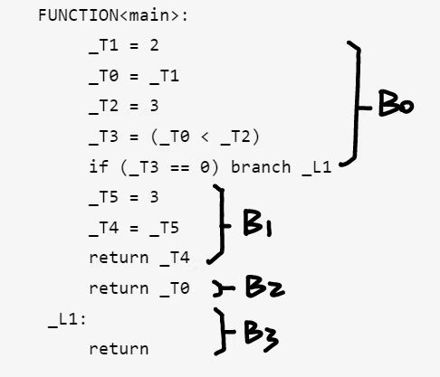
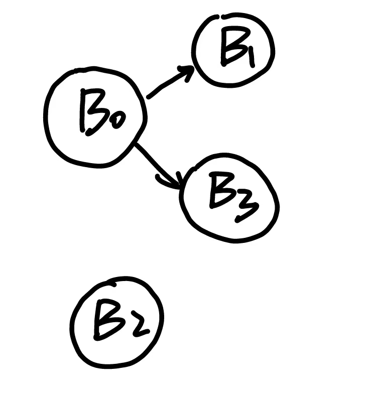
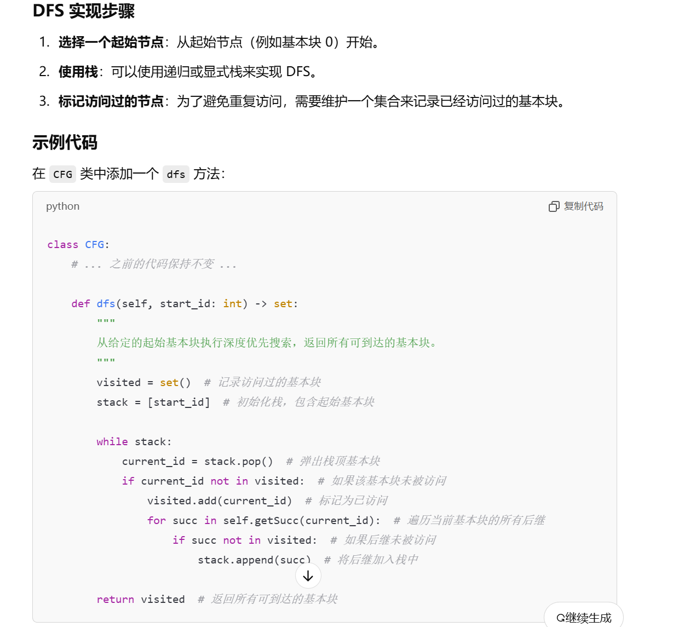

### MiniDecaf-Stage3 报告
周轻扬 2022012166 计24

##### 实验内容
增加了对于作用域和块语句的支持
1. 在语义分析部分的代码中：
   - 在`fronted/scope/scopestack.py`中实现了ScopeStack数据结构，主要维护了作用域栈，将栈中所有作用域元素用list存储，并维护了当前作用域current_scope和全局作用域global_scope变量。实现了在栈中添加元素的open方法，删除元素的close方法，获取当前作用域的current_scope方法，获取全局作用域的global_scope方法，在当前作用域中查找元素的lookup_current方法，在栈中查找元素lookup_all方法，在当前作用域中声明变量的declare方法。
        ```python
          class ScopeStack:
            def __init__(self, GlobalScope: Scope) -> None:
                self.scopes: list[Scope] = []# stack of scopes
                self.scopes.append(GlobalScope)
                self.current_scope: Scope = GlobalScope# top
                self.global_scope: Scope = GlobalScope# bottom
            def open(self, scope: Scope) -> None:
                self.scopes.append(scope)
                self.current_scope = scope
            def close(self) -> None:
                if(len(self.scopes)>0):
                    self.scopes.pop()
                    self.current_scope = self.scopes[-1]
                else:
                    raise Exception("ScopeStack is empty")
            def current_scope(self) -> Scope:
                return self.current_scope
            def global_scope(self) -> Scope:
                return self.global_scope
            def lookup_all(self, name: str) -> Optional[Symbol]:
                for scope in reversed(self.scopes):
                    symbol = scope.lookup(name)
                    if symbol is not None:
                        return symbol
                return None
            def lookup_current(self, name: str) -> Optional[Symbol]:
                return self.current_scope.lookup(name)
            def declare(self, symbol: Symbol) -> None:
                self.current_scope.declare(symbol)
        ```
    - 在`frontend/typecheck/namer.py`中将所有Scope类型变量改为ScopeStack类型，即在考虑作用域和块语句时需要考虑多重作用域嵌套，需要用作用域栈ScopeStack存储上下文信息，而非使用单一作用域的Scope类型变量存储。
    - 在`frontend/typecheck/namer.py`中修改`visitBlock`，在进入块语句时，调用open函数，创建新的局部作用域并将其压栈，在离开块语句时，调用close函数，将相应作用域退栈。
        ```python
          def visitBlock(self, block: Block, ctx: ScopeStack) -> None:
            ctx.open(Scope(ScopeKind.LOCAL))
            for child in block:
                child.accept(self, ctx)
            ctx.close()
        ```
    - 在`frontend/typecheck/namer.py`中，修改`visitDeclaration`、`visitAssignment`、`visitIdentifier`函数中对于lookup函数的调用。在`visitDeclaration`调用lookup_current，即只在当前作用域查找变量声明，判断是否存在重名变量错误；在`visitAssignment`和`visitIdentifier`调用lookup_all，即在整个作用域查找变量声明，判断是否存在未声明变量错误。
2. 在`backend`分配寄存器的代码中：
    - 在`backend/dataflow/cfg.py`中在CFG类中添加判断块是否可达的函数`is_unreachable`，用于判断当前块是否可达，从而决定是否需要为其分配寄存器。该函数通过reachable列表判断当前块是否可达，reachable列表在__init__中通过dfs计算得到。
        ```python
          def __init__(self, nodes: list[BasicBlock], edges: list[(int, int)]) -> None:
              self.nodes = nodes
              self.edges = edges

              self.links = []

              for i in range(len(nodes)):
                  self.links.append((set(), set()))

              for (u, v) in edges:
                  self.links[u][1].add(v)
                  self.links[v][0].add(u)

              """
              You can start from basic block 0 and do a DFS traversal of the CFG
              to find all the reachable basic blocks.
              """
              self.reachable=[False for _ in range(len(nodes))]
              next=[0]
              while len(next)>0:
                  u=next.pop()
                  if not self.reachable[u]:
                      self.reachable[u]=True
                      for v in self.links[u][1]:
                          if not self.reachable[v]:
                              next.append(v)
              return

          def is_unreachable(self, id) -> bool:
              return not self.reachable[id]
        ```
    - 在`backend/reg/bruteregalloc.py`中accept函数分配寄存器时，调用is_unreachable函数，若当前块不可达则跳过，不必分配寄存器。
        ```python
          def accept(self, graph: CFG, info: SubroutineInfo) -> None:
            subEmitter = RiscvSubroutineEmitter(self.emitter, info)
            for bb in graph.iterator():
                # you need to think more here
                # maybe we don't need to alloc regs for all the basic blocks
                if graph.is_unreachable(bb.id):
                    continue
                if bb.label is not None:
                    subEmitter.emitLabel(bb.label)
                self.localAlloc(bb, subEmitter)
            subEmitter.emitFunc()
        ```

##### 思考题
1. 请画出下面 MiniDecaf 代码的控制流图。
   ```c++
      int main(){
       int a = 2;
       if (a < 3) {
           {
               int a = 3;
               return a;
           }
           return a;
       }
      }
   ```
      答：生成汇编如下：
      ```
        FUNCTION<main>:
             _T1 = 2
             _T0 = _T1
             _T2 = 3
             _T3 = (_T0 < _T2)
             if (_T3 == 0) branch _L1
             _T5 = 3
             _T4 = _T5
             return _T4
             return _T0
         _L1:
             return
      ```
      
      


##### 参考资料
在补全`backend/dataflow/cfg.py`时借鉴了chatgpt生成的dfs模版：

保证自己独立完成实验。